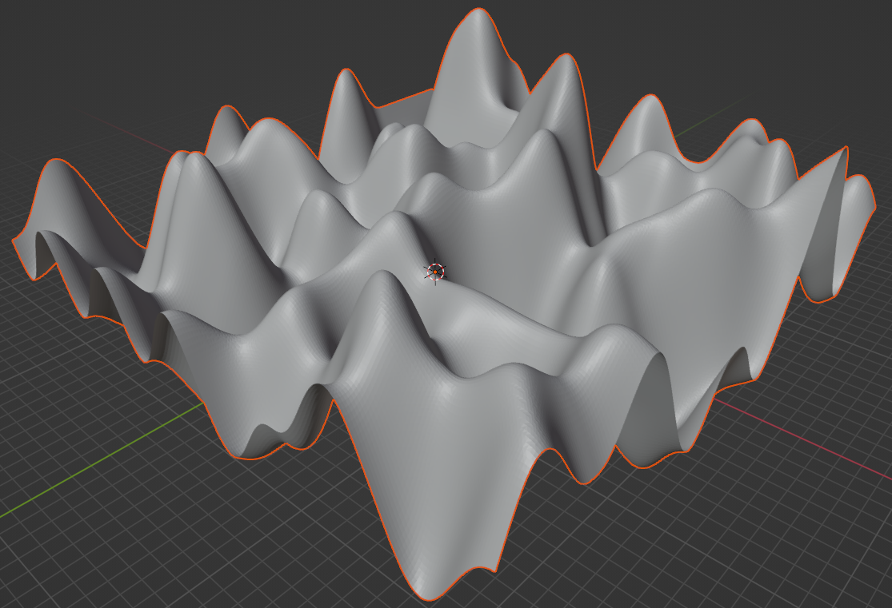
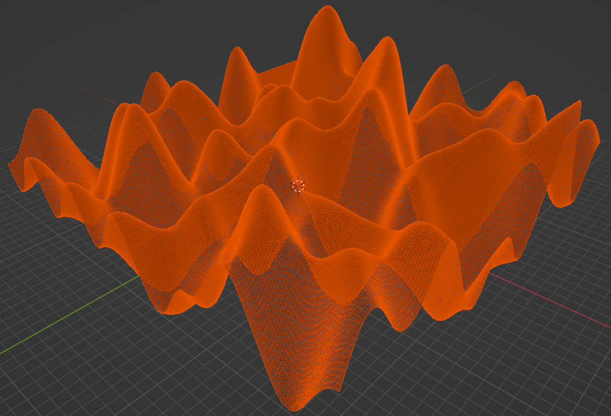

# Terrain Generation Benchmark

A C and CUDA benchmark for **procedural 3D terrain generation**, comparing single-threaded CPU, multicore CPU and GPU implementations in terms of execution time, energy consumption and Energy–Delay Product (EDP).

The terrain pipeline uses **Perlin Noise** to create terrain height data and **Marching Cubes** to extract a triangular surface. The resulting mesh can be exported as a Wavefront OBJ file for inspection in tools such as Blender or MeshLab.

## Example output

<p align="center">
  
  
</p>
<p align="center">
  <em>The same 256 × 256 × 256 terrain generated using default parameters, shown in Blender: solid shading (left) and selected-mesh view (right).</em>
</p>

## Implementations
| Variant |	Description |
|---|---|
| Single-threaded CPU |	Runs the CPU terrain generator with one OpenMP thread (-t 1). |
| Multicore CPU (OpenMP) |	Parallelizes CPU execution across multiple OpenMP threads. |
| GPU (CUDA) |	Executes GPU kernels implemented in .cu files, coordinated by C host-side code. |
| Benchmark harness |	Repeats executions, collects timing and energy measurements, and generates per-run and summary CSV files. |

The benchmark records CPU package energy using Linux RAPL/powercap interfaces. GPU energy measurement uses NVIDIA Management Library (NVML), selecting an available measurement method based on GPU and driver support. Depending on the device, energy may be obtained directly from NVML's total energy consumption counter or estimated by sampling GPU power over the execution interval. If neither method is available, GPU energy measurement is reported as unavailable.

## Repository layout

```text
.
├── benchmark/                 # Benchmark CLI, RAPL and NVML
├── common/                    # Perlin Noise interface, Marching Cubes tables, mesh types, OBJ export
├── cuda/                      # C host code and CUDA kernels (.cu)
├── docs/		               # Project documentation and supporting materials
├── openmp/                    # C CPU implementation using OpenMP
├── results.md                 # Experimental methodology, plots, and analysis
└── usage.md                   # Dependencies, RAPL permissions, build and run instructions
```

## Build and run

Build the project from the repository root using GNU Make:

```bash
make
```

For setup instructions, dependencies, permissions, benchmark execution and usage details, see the **[Usage](usage.md)**.

## Benchmark results

Benchmark findings, performance and energy comparisons, and result visualizations are presented in **[Results](results.md)**.

## Tested environment

The recorded experiments were collected on Ubuntu 22.04.5 LTS with an Intel Core i5-2400 CPU (4 cores / 4 threads), 8 GB DDR3 RAM, and an NVIDIA GeForce GTX 1050 Ti with 4 GB GDDR5 memory.

## License

This project is licensed under the MIT License. See the [LICENSE](LICENSE) file for details.