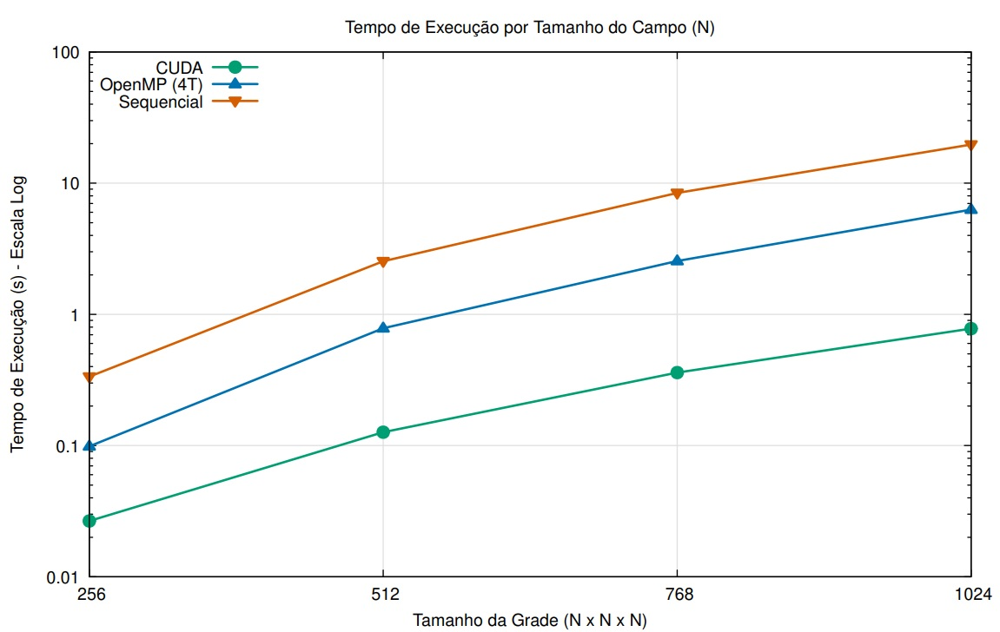
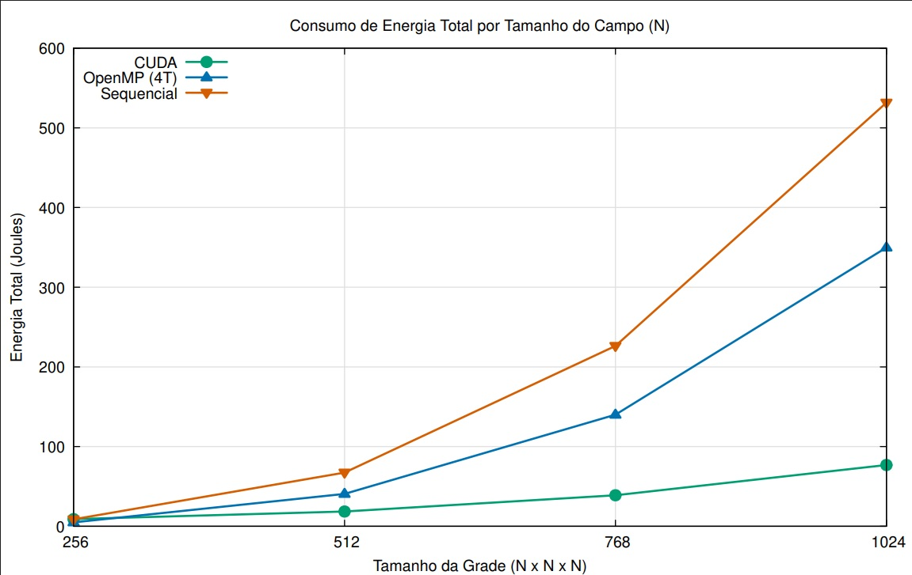

# Benchmark Results

This section presents the performance and energy measurements of the procedural terrain generator, comparing execution time, energy consumption, energy savings relative to the sequential CPU baseline, and Energy–Delay Product (EDP). The benchmarks evaluate CPU and GPU implementations under default operating conditions, with additional experiments on CPU frequency scaling and GPU power limits to investigate performance–energy trade-offs.

## Experimental setup
- **CPU**: Intel Core i5-2400 (4 cores / 4 threads), 8 GB DDR3 RAM.
- **GPU**: NVIDIA GeForce GTX 1050 Ti with 4 GB GDDR5.
- **Operating system**: Ubuntu 22.04.5 LTS.
- **Implementations**: sequential baseline (the OpenMP executable run with one thread), OpenMP with 4 threads, and CUDA.
- **Workloads**: Perlin-Noise terrain fields with cubic grid dimensions `N × N × N`, where `N` is the resolution along each axis and takes the values `256`, `512`, `768`, and `1024`, followed by mesh extraction using Marching Cubes.
- **Repetitions**: 10 measured runs per configuration, preceded by one warm-up run. Results are reported as means, with error bars indicating ±1 standard deviation.
- **Random seed**: 1234 for the main grid-size benchmarks.
- **Measured execution**: terrain field generation and Marching Cubes. OBJ export was disabled during benchmark runs.

## Measurement methodology
- **Energy consumption**: CPU-only implementations use the CPU-package RAPL counter. For CUDA, energy includes CPU-package energy and GPU energy estimated by integrating power samples collected through NVML. The idle GPU is excluded from CPU-only measurements.
- **Execution time**: measured using the application's reported execution time.
- **Speedup**: computed as the sequential baseline's mean execution time divided by the corresponding implementation's mean execution time at the same grid size.
- **Energy–Delay Product (EDP)**: calculated for each run as measured energy multiplied by process wall time. Reported EDP values are the mean of the per-run products.

## Commands Used for the Experiments

The following commands were used to collect the benchmark measurements:

```bash
mkdir -p results/sequential results/openmp_4t results/cuda

for N in 256 512 768 1024; do
    ./benchmark/bench \
        -b ./openmp/terrain_gen_openmp -n 10 \
        -o "./results/sequential/n${N}" \
        -- -x "$N" -y "$N" -z "$N" -t 1 -s 1234 || break
done

for N in 256 512 768 1024; do
    ./benchmark/bench \
        -b ./openmp/terrain_gen_openmp -n 10 \
        -o "./results/openmp_4t/n${N}" \
        -- -x "$N" -y "$N" -z "$N" -t 4 -s 1234 || break
done

for N in 256 512 768 1024; do
    ./benchmark/bench \
        -b ./cuda/terrain_gen_cuda -n 10 -g \
        -o "./results/cuda/n${N}" \
        -- -x "$N" -y "$N" -z "$N" -s 1234 || break
done
```

## 1. Execution time and speedup

<p align="center">
  
  <br>
  <em>Figure 1. Mean execution time by grid resolution, N (per axis); lower is better. The vertical axis is logarithmic.</em>
</p>

| Grid resolution, N (per axis) | Sequential (s) | OpenMP 4 threads (s) | OpenMP speedup | CUDA (s) | CUDA speedup |
|---:|---:|---:|---:|---:|---:|
| 256 | 0.335 | 0.099 | 3.39× | 0.027 | 12.57× |
| 512 | 2.538 | 0.784 | 3.24× | 0.127 | 20.06× |
| 768 | 8.428 | 2.550 | 3.31× | 0.360 | 23.43× |
| 1024 | 19.683 | 6.281 | 3.13× | 0.778 | 25.29× |

OpenMP maintains a relatively consistent speedup across all tested grid sizes, while CUDA scales more favorably as the workload increases. At the largest grid size, CUDA completes the workload in less than one second, demonstrating a substantial performance advantage over both CPU implementations.

## 2. Energy consumption and EDP

<p align="center">
  
  <br>
  <em>Figure 2. Mean measured energy for each implementation.</em>
</p>

At `N = 1024`, CUDA reduces measured energy consumption by 85.53% relative to the sequential baseline, while OpenMP with four threads achieves a 34.21% reduction. This highlights CUDA's advantage in energy efficiency for the largest tested workload.

The Energy–Delay Product (EDP) combines energy consumption and execution time, with lower values indicating a more favorable performance–energy trade-off. The table below summarizes the EDP across all tested grid dimensions.

| Grid resolution, N (per axis) | Sequential (J·s) | OpenMP 4 threads (J·s) | CUDA (J·s) |
|---:|---:|---:|---:|
| 256 | 2.965 | 0.491 | 1.311 |
| 512 | 171.388 | 32.469 | 4.814 |
| 768 | 1,909.696 | 359.011 | 19.294 |
| 1024 | 10,472.225 | 2,209.106 | 70.872 |

## 3. CPU-frequency tuning at `N = 1024`

The CPU frequency was varied across seven configured settings, from 1600 to 3400 MHz, to evaluate its effect on execution time, energy consumption and EDP. The sequential and OpenMP implementations were measured using CPU-package energy, while the CUDA experiment evaluates the effect of host CPU frequency on the complete GPU execution path.

The sequential implementation achieves its lowest measured energy at 2200 MHz (474.10 J), while OpenMP with four threads reaches its minimum at 1600 MHz (249.58 J). However, OpenMP achieves its lowest EDP at 3100 MHz (1,990.34 J·s) and its shortest execution time at 3400 MHz (6.013 s). These results show that the frequency that minimizes energy consumption does not necessarily provide the best performance–energy trade-off.

### 3.1 Energy across the frequency sweep

The table reports measured energy at each configured CPU frequency. Energy reductions are calculated relative to the sequential baseline at `N = 1024` (531.52 J), measured under the default CPU frequency-scaling policy, without a manually fixed frequency. Negative values indicate higher energy consumption than this baseline.

| CPU frequency | Sequential (J; reduction) | OpenMP 4 threads (J; reduction) | CUDA (J; reduction) |
|---:|---:|---:|---:|
| 1600 MHz | 502.55 (5.45%) | 249.58 (53.04%) | 75.93 (85.71%) |
| 1900 MHz | 480.68 (9.56%) | 257.41 (51.57%) | 73.61 (86.15%) |
| 2200 MHz | 474.10 (10.80%) | 268.00 (49.58%) | 73.91 (86.09%) |
| 2500 MHz | 482.92 (9.14%) | 280.88 (47.16%) | 73.64 (86.15%) |
| 2800 MHz | 483.69 (9.00%) | 298.61 (43.82%) | 74.82 (85.92%) |
| 3100 MHz | 497.51 (6.40%) | 322.81 (39.27%) | 76.05 (85.69%) |
| 3400 MHz | 534.60 (−0.58%) | 339.19 (36.19%) | 78.39 (85.25%) |

**CUDA host-frequency behavior.** In this experiment, only the host CPU frequency is varied; the GPU power limit is not modified. As the host CPU frequency increases from `1600` to `3400 MHz`, CUDA execution time decreases from `0.9225 s` to `0.7746 s` (16.03%). Over the same range, measured GPU energy decreases from `60.92 J` to `51.61 J` (15.28%), while CPU-package energy increases from `15.01 J` to `26.78 J` (78.41%).

The overall energy results show that increasing the host CPU frequency does not necessarily improve energy efficiency: total measured CUDA energy is lowest at `1900 MHz` (`73.61 J`), while the `3400 MHz` configuration consumes `78.39 J`.

### Best frequency by objective

| Objective | Sequential CPU | OpenMP (4 threads) | CUDA (host CPU frequency) |
|:---|:---|:---|:---|
| **Lowest energy** | 2200 MHz — 474.10 J; saves 57.43 J (10.80%) | 1600 MHz — 249.58 J; saves 281.94 J (53.04%) | 1900 MHz — 73.61 J; saves 457.91 J (86.15%) |
| **Lowest EDP** | 3400 MHz — 10,526.36 J·s | 3100 MHz — 1,990.34 J·s | 3100 MHz — 70.21 J·s |
| **Shortest time** | 3400 MHz — 19.671 s (1.00×) | 3400 MHz — 6.013 s (3.27×) | 3400 MHz — 0.775 s (25.41×) |

## 4. GPU power-limit experiment

The GPU power limit was varied across 52.5, 57.5, 62.5, 67.5 and 75 W, while keeping the workload and implementation fixed. The primary analysis uses `N = 1024`, matching the largest grid in the main benchmark and the CPU-frequency study. Each setting contains 10 measured runs after one warm-up run. The reported energy combines CPU-package energy from RAPL and GPU energy estimated from NVML.

### 4.1. Results at `N = 1024`

| GPU power limit | Execution time (s; change) | Total energy (J; change) | EDP (J·s; change) |
|:---|:---:|:---:|:---:|
| 52.5 W | 0.913; +17.27% | 78.60; +0.57% | 82.88; +14.00% |
| 57.5 W | 0.850; +9.14% | 77.25; −1.17% | 76.31; +4.97% |
| 62.5 W | 0.806; +3.55% | 77.09; −1.36% | 73.32; +0.86% |
| 67.5 W | 0.780; +0.13% | 77.78; −0.48% | 72.29; −0.56% |
| 75 W | 0.779; baseline | 78.16; baseline | 72.70; baseline |

At `N = 1024`, the 62.5 W limit achieves the lowest mean energy (77.09 J), while 67.5 W provides the lowest EDP (72.29 J·s). The 75 W setting delivers the shortest execution time. However, the differences in energy and EDP are small.
